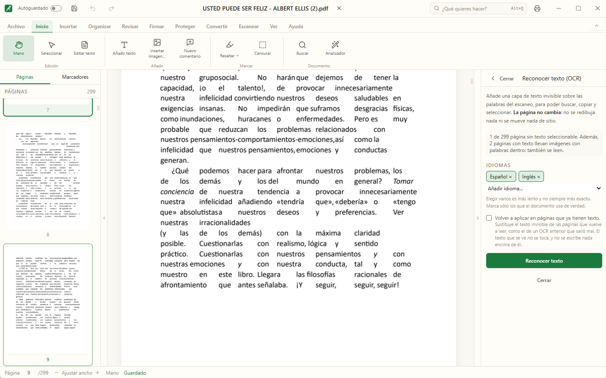
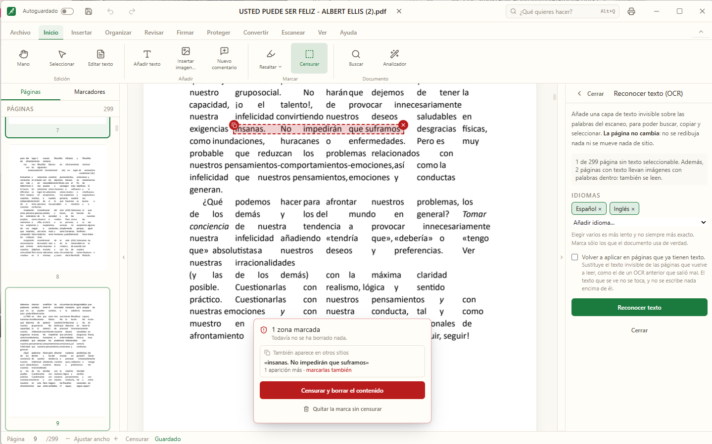
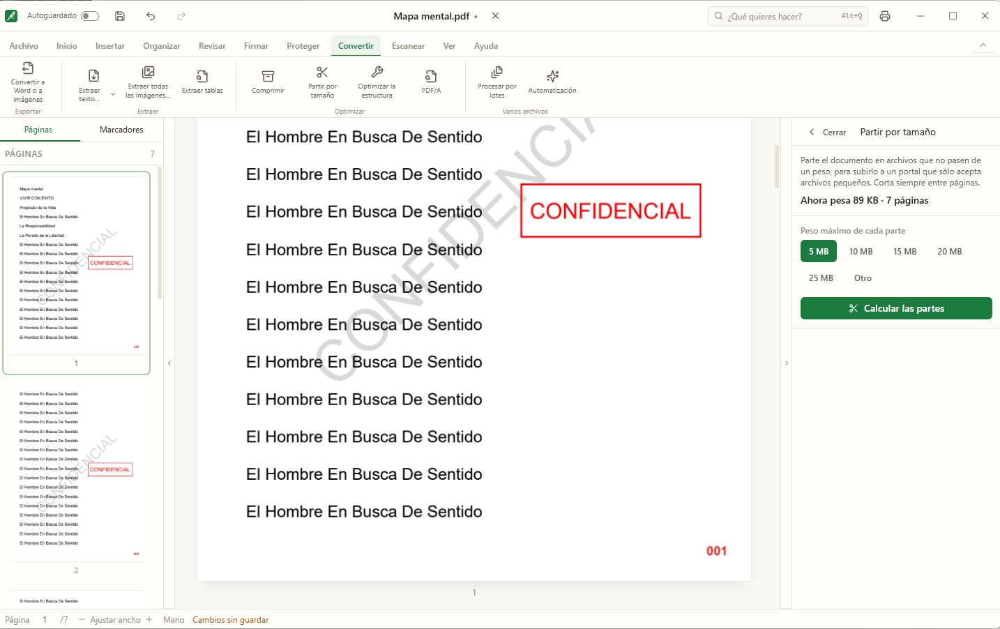
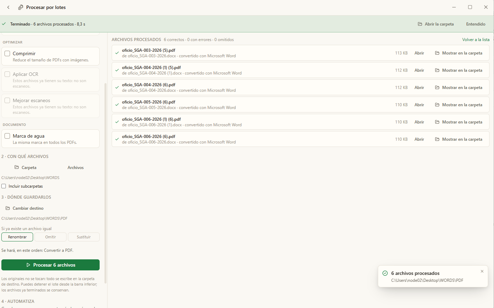
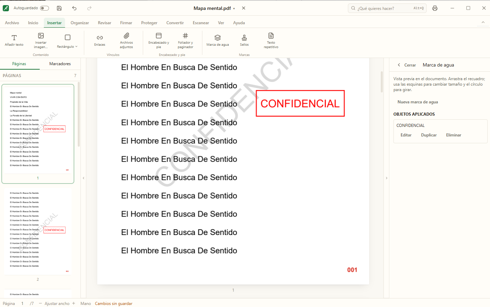

<p align="center">
  
</p>

<h1 align="center">Urraca PDF</h1>

<p align="center">
  <strong>The Windows PDF editor that never uploads your files anywhere.</strong><br/>
  <em>El editor de PDF para Windows que no sube tus archivos a ningún lado.</em>
</p>

<p align="center">
  <a href="https://urracapdf.com/download/"></a>
  <a href="https://urracapdf.com/"></a>
  <a href="https://urracapdf.com/pricing/"></a>
</p>

---

> **Notice / Aviso:** This public repository hosts **official Windows releases, SHA-256 verification checksums, public roadmap, and community bug reports / feature requests** for [Urraca PDF](https://urracapdf.com). Urraca PDF is commercial proprietary software.

---

## English

### Why Urraca PDF?
Most "free" online PDF tools require you to upload contracts, tax records, IDs, and medical documents to third-party servers. Desktop suites like Adobe Acrobat lock basic workflows behind expensive monthly subscriptions.

**Urraca PDF** runs 100% locally on your Windows PC:
- **Edit:** Modify text and images directly in place while preserving original fonts and layout.
- **Convert:** Convert between PDF, Word, and images without leaving your machine.
- **Organize:** Merge, split by file size or page count, reorder, rotate, and delete pages.
- **Local OCR:** Turn scanned PDFs and photos into searchable, selectable text offline.
- **Protect & Redact:** Permanently redact sensitive information, apply passwords, and restrict permissions.
- **Sign, Stamp & Bates Numbering:** Sign forms, flatten documents, add watermarks, stamps, and folio/Bates numbers.
- **Batch Processing & Direct TWAIN Scanning:** Process folders of PDFs in bulk and scan straight from hardware scanners.

### Download & Verify (v1.7.1)
- **Official Installer (Windows 10 & 11 64-bit, 26.6 MB):** [`Urraca_1.7.1_x64-setup.exe`](https://urracapdf.com/dl/Urraca_1.7.1_x64-setup.exe)
- **Download Page:** https://urracapdf.com/download/

Verify installer integrity in PowerShell:
```powershell
Get-FileHash .\Urraca_1.7.1_x64-setup.exe -Algorithm SHA256
# Expected: 368B854E7226F704E2DF6275B60F062F4E74906FB813AD9C6341673342C5B93A
```

### Screenshots
| Local OCR | Permanent Redaction |
|---|---|
|  |  |

| Split by File Size | Batch Processing |
|---|---|
|  |  |

| Stamps, Watermarks & Bates Numbering |
|---|
|  |

### Pricing
- **Free (US$0 forever):** All basic tools unlimited + 2 premium operations/day (plus 7-day unlimited trial on install). No ads, no watermarks.
- **Personal (US$12/year):** Unlimited everything on 1 PC.
- **Family (US$24/year):** Unlimited everything on up to 3 PCs.
- **Business (from US$36/PC/year):** 5+ PCs, silent Group Policy deploy, volume licensing.

---

## Español

### ¿Por qué Urraca PDF?
Las herramientas web gratuitas te obligan a subir contratos, identificaciones y estados de cuenta a servidores externos. **Urraca PDF** procesa todo **100% en tu computadora Windows**, sin publicidad y sin subir archivos a ninguna nube:
- **Editar y Convertir:** Edita texto e imágenes directo en la página; convierte entre PDF, Word e imágenes en local.
- **OCR Local:** Convierte documentos escaneados en texto buscable y editable sin conexión a internet.
- **Censura Permanente y Protección:** Elimina datos sensibles de forma irreversible, cifra con contraseña y restringe permisos.
- **Dividir por Peso, Lotes, Sellos y Foliador:** Herramientas pensadas para despachos jurídicos, contadores y oficinas.

### Descarga y verificación (v1.7.1)
- **Instalador oficial (Windows 10 y 11 de 64 bits, 26.6 MB):** [`Urraca_1.7.1_x64-setup.exe`](https://urracapdf.com/dl/Urraca_1.7.1_x64-setup.exe)
- **Página oficial:** https://urracapdf.com/es/descargar/

Verifica el hash SHA-256 en PowerShell:
```powershell
Get-FileHash .\Urraca_1.7.1_x64-setup.exe -Algorithm SHA256
# Esperado: 368B854E7226F704E2DF6275B60F062F4E74906FB813AD9C6341673342C5B93A
```

---

## Support / Soporte
- Website: https://urracapdf.com
- Support Email: `support@urracapdf.com`
- Bug Reports & Feature Requests: Open an [Issue](../../issues) using our templates.
